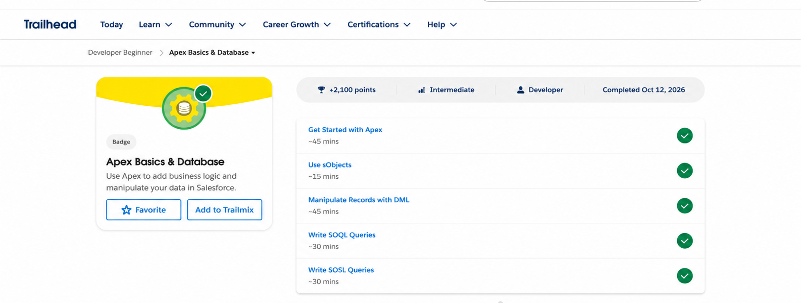
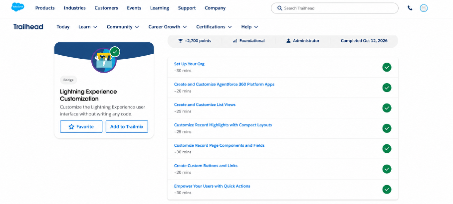
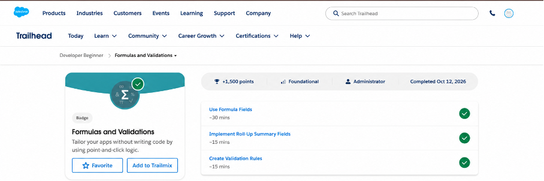
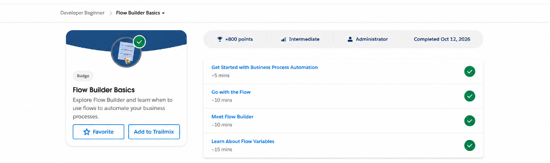
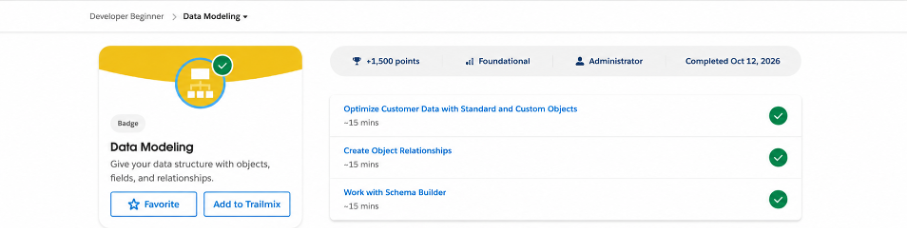

# Enterprise_Software_Salesforce_Assignment

##Apex Basics and Database
I learned the fundamentals of Apex, Salesforce’s programming language.
The module covered variables, collections, conditional statements, loops, and classes.
I also learned how to use SOQL and DML operations to query and update Salesforce records.
These concepts helped me understand how to build customized Salesforce solutions.

 
##Lightning Experience Customization
I learned how to customize the Salesforce Lightning interface for different users.
The module covered app navigation, page layouts, record pages, fields, and list views.
I practiced organizing information so users can access important records and features easily.
This improves user productivity and creates a better Salesforce experience.

 
#Formulas and Validations
I learned how to use formula fields to automatically calculate and display values.
I also studied validation rules that prevent users from entering incorrect or incomplete data.
These tools help automate calculations and maintain data accuracy.
They reduce manual work and improve the quality of Salesforce records.

 
##Flow Builder Basics
I learned how to use Flow Builder to automate business processes in Salesforce.
The module introduced screen flows, record-triggered flows, decisions, assignments, and updates.
Flows can automatically perform tasks when specific conditions are met.
This allows organizations to automate processes with little or no coding.

 
##Data Modeling
I learned how Salesforce organizes and connects information using objects and fields.
The module covered standard objects, custom objects, relationships, and schema design.
I studied lookup and master-detail relationships between records.
This helped me understand how to create an efficient and organized Salesforce database.

 

